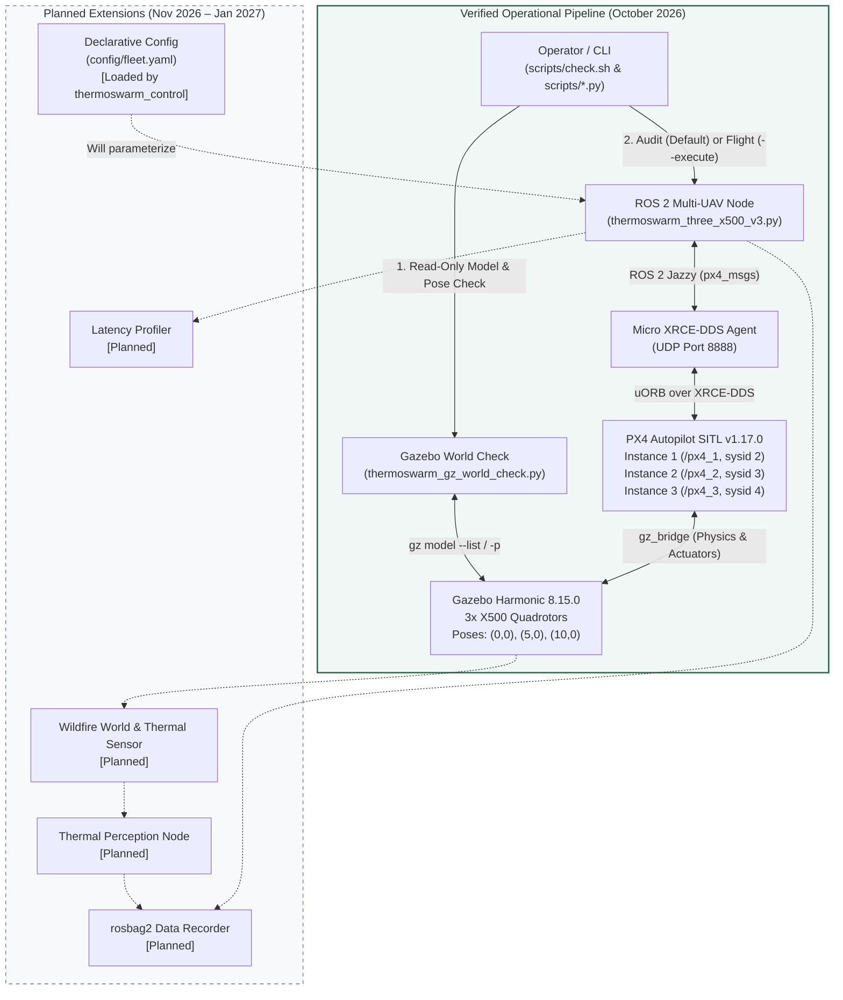

# ThermoSwarm: Multi-UAV Thermal Digital Twin Simulation for Wildfire Research

**ThermoSwarm** is a Software-in-the-Loop (SITL) research and verification platform designed to simulate coordinated multi-UAV operations over wildfire environments using **ROS 2 Jazzy**, **PX4 Autopilot v1.17.0**, **Gazebo Harmonic**, and **Micro XRCE-DDS**.

> **Project Status (October 2026):** The multi-UAV flight control and pre-flight verification foundation is **operational and verified** (3× X500 autonomous Offboard takeoff, 15/15 waypoint navigation, return-to-home, landing, and disarm). Thermal camera perception, wildfire world modeling, `rosbag2` data logging, and inter-node latency benchmarking are **in the planned architecture phase** and have not yet been implemented.

---

## Table of Contents

1. [Project Purpose and Scope](#1-project-purpose-and-scope)
2. [Technology Stack](#2-technology-stack)
3. [Current Capabilities and Verification Evidence](#3-current-capabilities-and-verification-evidence)
4. [System Architecture](#4-system-architecture)
5. [Repository Structure and Component Responsibilities](#5-repository-structure-and-component-responsibilities)
6. [Environment Setup and ROS 2 Workspace Preparation](#6-environment-setup-and-ros-2-workspace-preparation)
7. [Launching the Three-UAV SITL Environment](#7-launching-the-three-uav-sitl-environment)
8. [Read-Only System Verification (`./scripts/check.sh`) and Flight Execution](#8-read-only-system-verification-scriptschecksh-and-flight-execution)
9. [Architecture Reference](#9-architecture-reference)
10. [Roadmap and Delivery Milestones](#10-roadmap-and-delivery-milestones)

---

## 1. Project Purpose and Scope

Wildfire monitoring and thermal hotspot mapping benefit significantly from coordinated multi-UAV fleets capable of operating at staggered altitudes with deterministic safety guarantees. Before deploying algorithms onto embedded companion computers (e.g., NVIDIA Jetson) or physical airframes, flight coordination, sensor pipelines, and fail-closed safety mechanisms must be rigorously validated in a reproducible Software-in-the-Loop (SITL) digital twin.

**Scope of ThermoSwarm:**
- **Multi-UAV Autonomous Coordination:** Simultaneous Offboard control of three quadrotors (`x500_1`, `x500_2`, `x500_3`) operating in isolated PX4 namespaces (`/px4_1`, `/px4_2`, `/px4_3`) with altitude separation (`5 m`, `8 m`, `11 m` AGL).
- **Fail-Closed Pre-Flight Diagnostics:** Automated detection of stale/orphan Gazebo models, physical spawn collisions, stale uORB/ROS 2 telemetry topics, and post-arm climb failures (`NO_CLIMB` guard).
- **Extensible Research Foundation:** Designed to incrementally integrate simulated thermal cameras, wildfire SDF environments, synchronized `rosbag2` multi-vehicle recording, and DDS/ROS 2 communication latency profiling without disrupting verified flight control logic.
- **Safety Boundary:** All scripts and configurations in this repository are strictly **SITL-only** and must never be executed on physical flight hardware.

---

## 2. Technology Stack

The platform is verified on **Ubuntu 24.04 LTS (WSL2)** with the following pinned software stack:

| Layer | Technology / Package | Verified Version / Branch | Role in ThermoSwarm |
| :--- | :--- | :--- | :--- |
| **Operating System** | Ubuntu LTS (WSL2) | 24.04 (`noble`) | Host execution environment |
| **Middleware** | ROS 2 | Jazzy Jalisco | Multi-UAV command, telemetry, and node orchestration |
| **Autopilot** | PX4 Autopilot | `v1.17.0` | Multi-instance SITL flight stack (`px4 -i 1`, `-i 2`, `-i 3`) |
| **Physics & Sensor Sim** | Gazebo | Harmonic (`8.15.0`) | Multi-vehicle rigid-body dynamics and world simulation |
| **DDS Bridge** | Micro XRCE-DDS Agent | `v2.4.3` | Bidirectional uORB ↔ ROS 2 DDS topic bridge over UDP |
| **ROS 2 Message Definitions** | `px4_msgs` | `release/1.17` | Exact message definitions matching PX4 v1.17 uORB topics |
| **Runtime Language** | Python | `3.12` | ROS 2 `rclpy` control nodes, world diagnostics, and unit tests |

---

## 3. Current Capabilities and Verification Evidence

To maintain strict academic and engineering transparency, ThermoSwarm distinguishes between **verified operational capabilities** and **planned modules**.

### Verified Milestones

- **October 19, 2026 — Three-UAV Autonomous Offboard Mission (PASS):**
  - Simultaneous arming and Offboard mode transition for 3× X500 quadrotors (`sysid` 2, 3, 4) at staggered altitudes (`5 m`, `8 m`, `11 m` AGL).
  - **15/15 waypoints completed** across all three vehicles (5 local NED waypoints per aircraft forming a 2 m square trajectory plus return-to-home).
  - Controlled descent, landing detection (`VehicleLandDetected`), and automatic disarm verified across all 3/3 instances.
- **October 21, 2026 — Read-Only Diagnostic Pipeline (`./scripts/check.sh`) (PASS):**
  - **`GZ CHECK PASS`:** Verified via `scripts/thermoswarm_gz_world_check.py` that the active Gazebo world contains only the expected models (`x500_1`, `x500_2`, `x500_3`, `ground_plane`) with valid minimum horizontal separation and zero orphan/interpenetrating airframes.
  - **`AUDIT PASS (3/3)`:** Verified via `scripts/thermoswarm_three_x500_v3.py` (audit mode) that all three PX4 SITL instances publish fresh `VehicleLocalPosition` (`xy_valid=True`, `z_valid=True`) and `VehicleStatus` (`pre_flight_checks_pass=True`) telemetry over ROS 2 without sending any actuator or arming commands.

### Component Status Matrix

| Capability / Component | Status | Implementation / Notes |
| :--- | :--- | :--- |
| **3× X500 PX4 SITL + Gazebo Harmonic Bringup** | **Verified** | Multi-instance (`-i 1`, `-i 2`, `-i 3`) with separated spawn poses |
| **Micro XRCE-DDS Multi-Namespace Bridge** | **Verified** | `/px4_1/fmu/...`, `/px4_2/fmu/...`, `/px4_3/fmu/...` |
| **Gazebo World Orphan & Collision Check** | **Verified** | `scripts/thermoswarm_gz_world_check.py` (`GZ CHECK PASS`) |
| **Read-Only 3-UAV Telemetry & Preflight Audit** | **Verified** | `scripts/thermoswarm_three_x500_v3.py` (default mode, `AUDIT PASS 3/3`) |
| **Single-Entrypoint Pre-Flight Check Script** | **Verified** | `./scripts/check.sh` (runs GZ check + 3-UAV audit sequentially) |
| **3-UAV Offboard Takeoff, Waypoint (15/15), RTH & Land** | **Verified** | `scripts/thermoswarm_three_x500_v3.py --execute` |
| **Post-Arm Climb Guard (`NO_CLIMB` Detection)** | **Verified** | Aborts if confirmed armed+Offboard vehicle climbs `< 0.5 m` in `10 s` |
| **Offline Unit Test Suite (`unittest`)** | **Verified** | `scripts/test_thermoswarm_three_x500_v3.py` (isolated `ROS_DOMAIN_ID=87`) |
| **Fleet YAML Configuration (`config/fleet.yaml`)** | **Integrated in `thermoswarm_control`** | Validated at startup; package installs the canonical YAML as Python package data |
| **Modular ROS 2 Packages (`thermoswarm_control`, `bringup`)** | **Planned** | Target architecture defined in `docs/ARCHITECTURE.md` |
| **Wildfire World (`wildfire_world.sdf`) & Thermal Camera** | **Not Started (Planned)** | Scheduled for Milestone 2 (December 2026) |
| **Thermal Hotspot Perception Node** | **Not Started (Planned)** | Scheduled for Milestone 2 (December 2026) |
| **Multi-UAV `rosbag2` Telemetry & Sensor Recording** | **Not Started (Planned)** | Scheduled for Milestone 2 (December 2026) |
| **Inter-Node ROS 2 Message Latency Benchmarking** | **Not Started (Planned)** | Scheduled for Milestone 3 (January 2027) |

---

## 4. System Architecture

The diagram below illustrates the current operational data flow (solid nodes) alongside the planned digital twin extensions (dashed nodes) defined in [`docs/ARCHITECTURE.md`](docs/ARCHITECTURE.md).



**Architectural Boundaries:**
- **Gazebo Harmonic** simulates rigid-body vehicle dynamics and the physical environment.
- **PX4 Autopilot SITL** executes inner-loop attitude/position control and navigation state machines for each UAV instance.
- **Micro XRCE-DDS Agent** acts as the mandatory middleware bridge translating PX4 uORB messages into ROS 2 DDS topics under `/px4_<instance>/fmu/in/*` and `/px4_<instance>/fmu/out/*`.
- **ROS 2 Control & Diagnostic Scripts** perform fail-closed pre-flight validation, publish `OffboardControlMode` heartbeats and `TrajectorySetpoint` targets at 20 Hz, verify command acknowledgments (`VehicleCommandAck`), and enforce safe landing/disarm sequences.

---

## 5. Repository Structure and Component Responsibilities

Below is the **actual current directory layout** of the repository and the exact role of each file:

```text
thermal-swarm-sitl-poc/
├── README.md                                     # Project overview, setup, verification, and roadmap
├── requirements-dev.txt                          # Offline PX4 ULog analysis dependencies (pyulog, numpy)
│
├── config/
│   └── fleet.yaml                                # Canonical fleet, route, and safety configuration
│
├── docs/
│   └── ARCHITECTURE.md                           # Target repository design, refactoring plan, and delivery roadmap
│
├── scripts/
│   ├── check.sh                                  # Read-only pre-flight pipeline: runs Gazebo check + 3-UAV telemetry audit
│   ├── thermoswarm_gz_world_check.py             # Read-only Gazebo model list and spawn collision detector
│   ├── thermoswarm_three_x500_v3.py              # Primary 3-UAV ROS 2 node: read-only audit (default) & autonomous mission (--execute)
│   ├── test_thermoswarm_three_x500_v3.py         # Offline unit test suite (isolated ROS_DOMAIN_ID=87, mocked publishers)
│   ├── thermoswarm_three_x500_audit_fixed.py     # Earlier 3-UAV control/audit iteration (retained for reference)
│   ├── thermoswarm_three_x500_test.py            # Initial 3-UAV Offboard test script (retained for reference)
│   ├── thermoswarm_waypoint_test.py              # Single-UAV 5-waypoint square trajectory SITL smoke test
│   └── thermoswarm_offboard_test.py              # Single-UAV basic Offboard takeoff/land SITL smoke test
│
├── ros2_ws/
│   └── src/
│       └── px4_msgs/                             # PX4 ROS 2 message definitions (release/1.17), built with colcon
│
├── PX4-Autopilot/                                # Local PX4 v1.17.0 source & SITL build tree (build/px4_sitl_default)
├── Micro-XRCE-DDS-Agent/                         # Local Micro XRCE-DDS Agent v2.4.3 source & build tree
├── .venv-ros/                                    # Python venv (--system-site-packages) for ROS 2 IDE/runtime integration
└── .venv-logs/                                   # Isolated Python venv for offline .ulg log analysis
```

> **Fleet configuration:** [`config/fleet.yaml`](config/fleet.yaml) is the single editable source for the three X500 vehicles, route offsets, and safety thresholds. The `thermoswarm_control` package validates it before creating the ROS node and includes it as package data. The retained v3 reference script is unchanged.

---

## 6. Environment Setup and ROS 2 Workspace Preparation

### 6.1 Python and ROS 2 Runtime Architecture

All flight and diagnostic scripts in `scripts/*.py` rely exclusively on:
1. **Python 3.12 Standard Library** (`argparse`, `dataclasses`, `math`, `os`, `re`, `subprocess`, `sys`, `time`, `types`, `unittest`),
2. **System ROS 2 Jazzy Python Packages** (`rclpy` located at `/opt/ros/jazzy/lib/python3.12/site-packages`),
3. **Compiled `px4_msgs` Package** (`ros2_ws/install/px4_msgs/lib/python3.12/site-packages`).

**Zero external `pip` packages are required at flight runtime.** Sourcing the ROS 2 setup files allows the system `/usr/bin/python3` interpreter to execute all flight and diagnostic scripts directly.

To keep development, IDE static analysis, and offline log processing cleanly separated, two virtual environments are used:

| Environment | Creation Command | Purpose |
| :--- | :--- | :--- |
| `.venv-ros` | `python3 -m venv --system-site-packages .venv-ros` | ROS 2 runtime & VS Code Pylance integration. Inherits system ROS packages via `--system-site-packages`; never install `rclpy` or `px4_msgs` via `pip`. |
| `.venv-logs` | `python3 -m venv .venv-logs` | Offline analysis of PX4 `.ulg` (ULog) flight logs using `pyulog` and `numpy` (`requirements-dev.txt`). Strictly isolated from ROS 2 runtime. |

> **Note on VS Code Pylance (`Import "rclpy.node" could not be resolved`):**
> This warning occurs when VS Code has not sourced `/opt/ros/jazzy/setup.bash` and `ros2_ws/install/setup.bash`. Configuring `python.defaultInterpreterPath` and `python.analysis.extraPaths` in `.vscode/settings.json` allows Pylance to resolve `rclpy`, `px4_msgs`, and `scripts/` modules directly.

### 6.2 Building `ros2_ws` (First-Time or After Clean)

If `ros2_ws/install/setup.bash` has not been built yet:

```bash
cd ~/projects/thermal-swarm-sitl-poc/ros2_ws
source /opt/ros/jazzy/setup.bash
colcon build --packages-select px4_msgs
```

### 6.3 Sourcing the Workspace in a New Terminal

Before running any ROS 2 script in a new shell session:

```bash
cd ~/projects/thermal-swarm-sitl-poc

# 1. Source ROS 2 Jazzy and the local px4_msgs workspace:
source /opt/ros/jazzy/setup.bash
source ros2_ws/install/setup.bash

# 2. (Optional) Activate the .venv-ros virtual environment:
source .venv-ros/bin/activate
```

### 6.4 Offline ULog Analysis Environment (`.venv-logs`)

To inspect PX4 `.ulg` logs independently of the ROS 2 runtime:

```bash
cd ~/projects/thermal-swarm-sitl-poc
source .venv-logs/bin/activate
# If installing for the first time: pip install -r requirements-dev.txt
ulog_messages PX4-Autopilot/build/px4_sitl_default/rootfs/1/log/<date>/<logfile>.ulg
```

---

## 7. Launching the Three-UAV SITL Environment

Running the complete three-vehicle simulation requires **Micro XRCE-DDS Agent** and **three PX4 SITL instances** connected to a single Gazebo Harmonic world.

### Step 1: Start the Micro XRCE-DDS Agent (Mandatory)

> **Critical Requirement:** The **Micro XRCE-DDS Agent** must be running continuously before and during any ROS 2 audit or flight session. Without the agent, PX4 uORB topics cannot bridge to ROS 2 DDS topics, and all telemetry checks will fail.

In **Terminal 1**:

```bash
MicroXRCEAgent udp4 -p 8888
```

### Step 2: Launch the Three PX4 SITL + Gazebo Harmonic Instances

Open three separate terminals. In each terminal, navigate to `PX4-Autopilot` and export `GZ_IP=127.0.0.1`:

- **Terminal 2 — Instance 1 (`x500_1`, `sysid=2`, `/px4_1`, spawns Gazebo server at `0, 0`):**
  ```bash
  cd ~/projects/thermal-swarm-sitl-poc/PX4-Autopilot
  export GZ_IP=127.0.0.1
  HEADLESS=1 PX4_SYS_AUTOSTART=4001 PX4_SIM_MODEL=gz_x500 PX4_GZ_MODEL_POSE="0,0" ./build/px4_sitl_default/bin/px4 -i 1
  ```

- **Terminal 3 — Instance 2 (`x500_2`, `sysid=3`, `/px4_2`, attaches to existing Gazebo server at `5, 0`):**
  ```bash
  cd ~/projects/thermal-swarm-sitl-poc/PX4-Autopilot
  export GZ_IP=127.0.0.1
  HEADLESS=1 PX4_GZ_STANDALONE=1 PX4_SYS_AUTOSTART=4001 PX4_SIM_MODEL=gz_x500 PX4_GZ_MODEL_POSE="5,0" ./build/px4_sitl_default/bin/px4 -i 2
  ```

- **Terminal 4 — Instance 3 (`x500_3`, `sysid=4`, `/px4_3`, attaches to existing Gazebo server at `10, 0`):**
  ```bash
  cd ~/projects/thermal-swarm-sitl-poc/PX4-Autopilot
  export GZ_IP=127.0.0.1
  HEADLESS=1 PX4_GZ_STANDALONE=1 PX4_SYS_AUTOSTART=4001 PX4_SIM_MODEL=gz_x500 PX4_GZ_MODEL_POSE="10,0" ./build/px4_sitl_default/bin/px4 -i 3
  ```

---

## 8. Read-Only System Verification (`./scripts/check.sh`) and Flight Execution

### 8.1 Automated Read-Only Pre-Flight Check (`./scripts/check.sh`)

Once the Micro XRCE-DDS Agent and all three PX4 SITL instances are running, verify the simulation state from **Terminal 5**:

```bash
cd ~/projects/thermal-swarm-sitl-poc
./scripts/check.sh
```

> **Safety Note:** `./scripts/check.sh` is **strictly read-only**. It **never arms the vehicles, never switches flight modes, and never initiates a flight**. It automatically sources `/opt/ros/jazzy/setup.bash` and `ros2_ws/install/setup.bash`, then executes two sequential verification stages:
> 1. **Gazebo World Sanity Check (`scripts/thermoswarm_gz_world_check.py`):** Queries Gazebo (`gz model --list` and `gz model -m <name> -p`) to confirm that only `x500_1`, `x500_2`, and `x500_3` (plus `ground_plane`) exist and that no two models violate the minimum horizontal separation threshold (`GZ CHECK PASS`).
> 2. **Three-UAV Telemetry & Pre-Flight Audit (`scripts/thermoswarm_three_x500_v3.py` without `--execute`):** Subscribes to `/px4_1`, `/px4_2`, and `/px4_3` telemetry topics and verifies fresh position validity (`xy_valid`, `z_valid`) and `pre_flight_checks_pass=True` across all 3/3 vehicles (`AUDIT PASS`).

### 8.2 Offline Syntax and Unit Tests (No Running SITL Required)

You can run static syntax compilation and the offline unit test suite at any time (even while SITL is running or stopped, as the test suite isolates itself on `ROS_DOMAIN_ID=87` and replaces all ROS publishers with test doubles):

```bash
cd ~/projects/thermal-swarm-sitl-poc
source /opt/ros/jazzy/setup.bash
source ros2_ws/install/setup.bash
source .venv-ros/bin/activate

# Python syntax verification
python3 -m py_compile scripts/*.py

# Offline unit tests (Gazebo collision detection, climb classification, mission logic)
ROS_DOMAIN_ID=87 python3 scripts/test_thermoswarm_three_x500_v3.py -v
```

### 8.3 Executing the Autonomous Three-UAV Mission

Only after `./scripts/check.sh` reports `CHECK PASS: GZ CHECK ve AUDIT başarılı`, launch the autonomous mission by passing the explicit `--execute` flag:

```bash
cd ~/projects/thermal-swarm-sitl-poc
source /opt/ros/jazzy/setup.bash
source ros2_ws/install/setup.bash
source .venv-ros/bin/activate
export GZ_IP=127.0.0.1

# Execute the 3-UAV autonomous mission (Takeoff -> 15/15 Waypoints -> RTH -> Land -> Disarm)
python3 scripts/thermoswarm_three_x500_v3.py --execute
```

---

## 9. Architecture Reference

For the detailed software engineering design, target ROS 2 package structure (`thermoswarm_control`, `thermoswarm_bringup`, `thermoswarm_perception`, `thermoswarm_recording`, `thermoswarm_monitoring`), single-source configuration principles, and phased refactoring rules, refer to:

- **[`docs/ARCHITECTURE.md`](docs/ARCHITECTURE.md)** — *ThermoSwarm Proposed Repository and Software Architecture*

---

## 10. Roadmap and Delivery Milestones

The development roadmap follows a staged, verification-first progression from multi-UAV flight control to a complete wildfire thermal digital twin:

| Phase / Target Date | Milestone | Key Deliverables | Status |
| :--- | :--- | :--- | :--- |
| **Milestone 0**<br>*(Oct 19–21, 2026)* | **Multi-UAV Offboard PoC & Fail-Closed Diagnostics** | • 3× X500 simultaneous Offboard flight (15/15 waypoints, RTH, land, disarm)<br>• Read-only Gazebo world collision detector (`GZ CHECK PASS`)<br>• Read-only 3/3 telemetry preflight audit (`AUDIT PASS`) via `./scripts/check.sh` | **Completed & Verified** |
| **Milestone 1**<br>*(Nov 15, 2026)* | **Standardized Multi-UAV Bringup & Control Package** | • Refactor flight control into `ros2_ws/src/thermoswarm_control` & `thermoswarm_bringup`<br>• Wire `config/fleet.yaml` as the single source of truth for vehicle parameters<br>• Standardized `sim.sh` / `check.sh` / `demo.sh` operational workflow | **In Progress (fleet config integrated)** |
| **Milestone 2**<br>*(Dec 15, 2026)* | **Wildfire Environment, Thermal Perception & Data Logging** | • Custom Gazebo wildfire world (`wildfire_world.sdf`) with thermal hotspots<br>• Thermal camera sensor integration on X500 models & `thermoswarm_perception` node<br>• Synchronized `rosbag2` recording (`thermoswarm_recording`) of pose, velocity, attitude, and thermal streams | **Planned** |
| **Milestone 3**<br>*(Jan 5 – Jan 31, 2027)* | **End-to-End Digital Twin Demo & Latency Profiling** | • Inter-node ROS 2 communication latency monitoring (`thermoswarm_monitoring`)<br>• Target integrated system demonstration (Jan 5) and final technical evaluation (Jan 31) | **Planned** |
