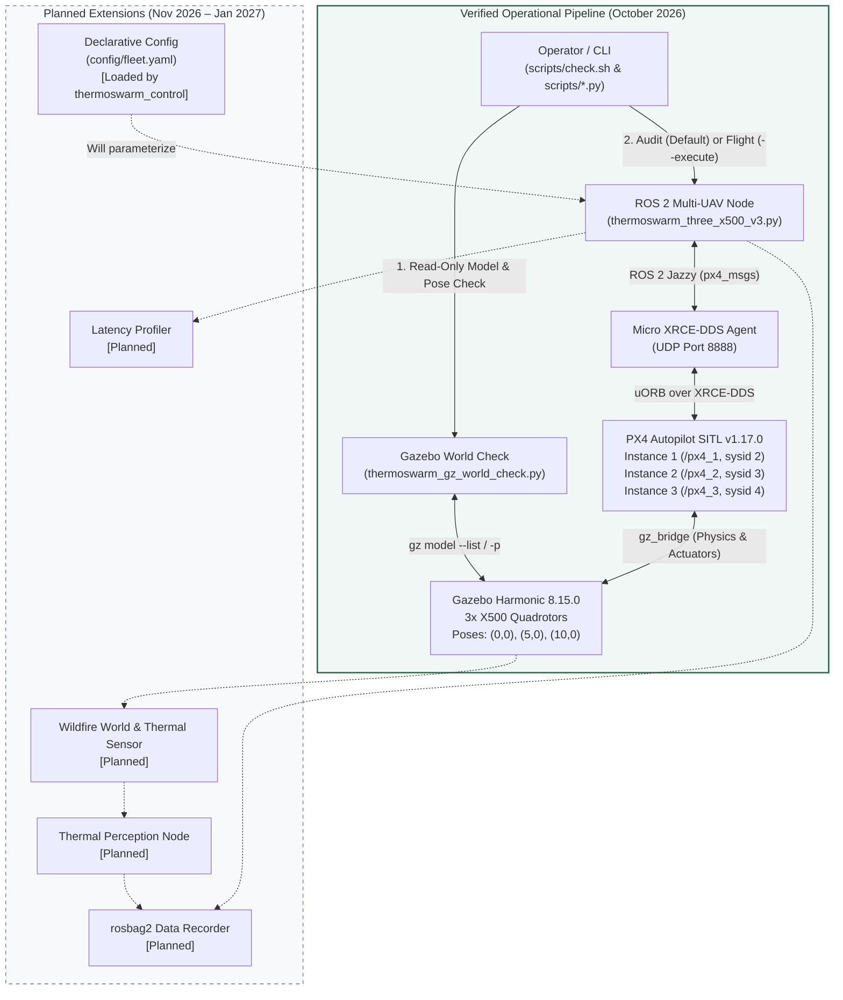

# ThermoSwarm: Multi-UAV Thermal Digital Twin Simulation for Wildfire Research

**ThermoSwarm** is a Software-in-the-Loop (SITL) research and verification platform designed to simulate coordinated multi-UAV operations over wildfire environments using **ROS 2 Jazzy**, **PX4 Autopilot v1.17.0**, **Gazebo Harmonic**, and **Micro XRCE-DDS**.

> **Project Status (October 2026):** The multi-UAV flight control and pre-flight verification foundation is **operational and verified** (3× X500 autonomous Offboard takeoff, 15/15 waypoint navigation, return-to-home, landing, and disarm). Phase 6 adds a minimal wildfire world and an X500-1 thermal image stream (Gazebo + ROS 2). Real rendering, image contrast, stationary three-UAV AUDIT and safe lifecycle checks are documented in [Phase 6](docs/PHASE6_VALIDATION.md). A wildfire waypoint flight has not been run in this phase. AI thermal perception, `rosbag2` logging and latency benchmarking remain planned.

---

## Table of Contents

1. [Project Purpose and Scope](#1-project-purpose-and-scope)
2. [Technology Stack](#2-technology-stack)
3. [Current Capabilities and Verification Evidence](#3-current-capabilities-and-verification-evidence)
4. [System Architecture](#4-system-architecture)
5. [Repository Structure and Component Responsibilities](#5-repository-structure-and-component-responsibilities)
6. [Environment Setup and ROS 2 Workspace Preparation](#6-environment-setup-and-ros-2-workspace-preparation)
7. [Simulation Lifecycle](#7-simulation-lifecycle)
8. [Read-Only System Verification (`./scripts/check.sh`) and Flight Execution](#8-read-only-system-verification-scriptschecksh-and-flight-execution)
9. [Architecture Reference](#9-architecture-reference)
10. [Roadmap and Delivery Milestones](#10-roadmap-and-delivery-milestones)

---

## 1. Project Purpose and Scope

Wildfire monitoring and thermal hotspot mapping benefit significantly from coordinated multi-UAV fleets capable of operating at staggered altitudes with deterministic safety guarantees. Before deploying algorithms onto embedded companion computers (e.g., NVIDIA Jetson) or physical airframes, flight coordination, sensor pipelines, and fail-closed safety mechanisms must be rigorously validated in a reproducible Software-in-the-Loop (SITL) digital twin.

**Scope of ThermoSwarm:**
- **Multi-UAV Autonomous Coordination:** Simultaneous Offboard control of three quadrotors (`x500_1`, `x500_2`, `x500_3`) operating in isolated PX4 namespaces (`/px4_1`, `/px4_2`, `/px4_3`) with altitude separation (`5 m`, `8 m`, `11 m` AGL).
- **Fail-Closed Pre-Flight Diagnostics:** Automated detection of stale/orphan Gazebo models, physical spawn collisions, stale uORB/ROS 2 telemetry topics, and post-arm climb failures (`NO_CLIMB` guard).
- **Extensible Research Foundation:** Designed to incrementally integrate simulated thermal cameras, wildfire SDF environments, synchronized `rosbag2` multi-vehicle recording, and DDS/ROS 2 communication latency profiling without disrupting verified flight control logic.
- **Safety Boundary:** All scripts and configurations in this repository are strictly **SITL-only** and must never be executed on physical flight hardware.

---

## 2. Technology Stack

The platform is verified on **Ubuntu 24.04 LTS (WSL2)** with the following pinned software stack:

| Layer | Technology / Package | Verified Version / Branch | Role in ThermoSwarm |
| :--- | :--- | :--- | :--- |
| **Operating System** | Ubuntu LTS (WSL2) | 24.04 (`noble`) | Host execution environment |
| **Middleware** | ROS 2 | Jazzy Jalisco | Multi-UAV command, telemetry, and node orchestration |
| **Autopilot** | PX4 Autopilot | `v1.17.0` | Multi-instance SITL flight stack (`px4 -i 1`, `-i 2`, `-i 3`) |
| **Physics & Sensor Sim** | Gazebo | Harmonic (`8.15.0`) | Multi-vehicle rigid-body dynamics and world simulation |
| **DDS Bridge** | Micro XRCE-DDS Agent | `v2.4.3` | Bidirectional uORB ↔ ROS 2 DDS topic bridge over UDP |
| **ROS 2 Message Definitions** | `px4_msgs` | `release/1.17` | Exact message definitions matching PX4 v1.17 uORB topics |
| **Runtime Language** | Python | `3.12` | ROS 2 `rclpy` control nodes, world diagnostics, and unit tests |

---

## 3. Current Capabilities and Verification Evidence

To maintain strict academic and engineering transparency, ThermoSwarm distinguishes between **verified operational capabilities** and **planned modules**.

### Verified Milestones

- **October 19, 2026 — Three-UAV Autonomous Offboard Mission (PASS):**
  - Simultaneous arming and Offboard mode transition for 3× X500 quadrotors (`sysid` 2, 3, 4) at staggered altitudes (`5 m`, `8 m`, `11 m` AGL).
  - **15/15 waypoints completed** across all three vehicles (5 local NED waypoints per aircraft forming a 2 m square trajectory plus return-to-home).
  - Controlled descent, landing detection (`VehicleLandDetected`), and automatic disarm verified across all 3/3 instances.
- **October 21, 2026 — Read-Only Diagnostic Pipeline (`./scripts/check.sh`) (PASS):**
  - **`GZ CHECK PASS`:** Verified via `scripts/thermoswarm_gz_world_check.py` that the active Gazebo world contains only the expected models (`x500_1`, `x500_2`, `x500_3`, `ground_plane`) with valid minimum horizontal separation and zero orphan/interpenetrating airframes.
  - **`AUDIT PASS (3/3)`:** Verified via `scripts/thermoswarm_three_x500_v3.py` (audit mode) that all three PX4 SITL instances publish fresh `VehicleLocalPosition` (`xy_valid=True`, `z_valid=True`) and `VehicleStatus` (`pre_flight_checks_pass=True`) telemetry over ROS 2 without sending any actuator or arming commands.

### Component Status Matrix

| Capability / Component | Status | Implementation / Notes |
| :--- | :--- | :--- |
| **3× X500 PX4 SITL + Gazebo Harmonic Bringup** | **Verified** | Multi-instance (`-i 1`, `-i 2`, `-i 3`) with separated spawn poses |
| **Micro XRCE-DDS Multi-Namespace Bridge** | **Verified** | `/px4_1/fmu/...`, `/px4_2/fmu/...`, `/px4_3/fmu/...` |
| **Gazebo World Orphan & Collision Check** | **Verified** | `scripts/thermoswarm_gz_world_check.py` (`GZ CHECK PASS`) |
| **Read-Only 3-UAV Telemetry & Preflight Audit** | **Verified** | `scripts/thermoswarm_three_x500_v3.py` (default mode, `AUDIT PASS 3/3`) |
| **Single-Entrypoint Pre-Flight Check Script** | **Verified** | `./scripts/check.sh` (runs GZ check + 3-UAV audit sequentially) |
| **3-UAV Offboard Takeoff, Waypoint (15/15), RTH & Land** | **Verified** | `scripts/thermoswarm_three_x500_v3.py --execute` |
| **Post-Arm Climb Guard (`NO_CLIMB` Detection)** | **Verified** | Aborts if confirmed armed+Offboard vehicle climbs `< 0.5 m` in `10 s` |
| **Offline Unit Test Suite (`unittest`)** | **Verified** | `scripts/test_thermoswarm_three_x500_v3.py` (isolated `ROS_DOMAIN_ID=87`) |
| **Fleet YAML Configuration (`config/fleet.yaml`)** | **Integrated in `thermoswarm_control`** | Validated at startup; package installs the canonical YAML as Python package data |
| **Modular ROS 2 Packages (`thermoswarm_control`, `bringup`)** | **Planned** | Target architecture defined in `docs/ARCHITECTURE.md` |
| **Wildfire World & X500-1 Thermal Camera** | **Minimal real sensor integration** | `sim.sh start --world wildfire`; [evidence and limits](docs/PHASE6_VALIDATION.md) |
| **Thermal Hotspot Perception Node** | **Not Started (Planned)** | Scheduled for Milestone 2 (December 2026) |
| **Multi-UAV `rosbag2` Telemetry & Sensor Recording** | **Not Started (Planned)** | Scheduled for Milestone 2 (December 2026) |
| **Inter-Node ROS 2 Message Latency Benchmarking** | **Not Started (Planned)** | Scheduled for Milestone 3 (January 2027) |

---

## 4. System Architecture

The diagram below illustrates the current operational data flow (solid nodes) alongside the planned digital twin extensions (dashed nodes) defined in [`docs/ARCHITECTURE.md`](docs/ARCHITECTURE.md).



**Architectural Boundaries:**
- **Gazebo Harmonic** simulates rigid-body vehicle dynamics and the physical environment.
- **PX4 Autopilot SITL** executes inner-loop attitude/position control and navigation state machines for each UAV instance.
- **Micro XRCE-DDS Agent** acts as the mandatory middleware bridge translating PX4 uORB messages into ROS 2 DDS topics under `/px4_<instance>/fmu/in/*` and `/px4_<instance>/fmu/out/*`.
- **ROS 2 Control & Diagnostic Scripts** perform fail-closed pre-flight validation, publish `OffboardControlMode` heartbeats and `TrajectorySetpoint` targets at 20 Hz, verify command acknowledgments (`VehicleCommandAck`), and enforce safe landing/disarm sequences.

---

## 5. Repository Structure and Component Responsibilities

Below is the **actual current directory layout** of the repository and the exact role of each file:

```text
thermal-swarm-sitl-poc/
├── README.md                                     # Project overview, setup, verification, and roadmap
├── requirements-dev.txt                          # Offline PX4 ULog analysis dependencies (pyulog, numpy)
│
├── config/
│   └── fleet.yaml                                # Canonical fleet, route, and safety configuration
│
├── docs/
│   └── ARCHITECTURE.md                           # Target repository design, refactoring plan, and delivery roadmap
│
├── scripts/
│   ├── check.sh                                  # Read-only pre-flight pipeline: runs Gazebo check + 3-UAV telemetry audit
│   ├── thermoswarm_gz_world_check.py             # Read-only Gazebo model list and spawn collision detector
│   ├── thermoswarm_three_x500_v3.py              # Primary 3-UAV ROS 2 node: read-only audit (default) & autonomous mission (--execute)
│   ├── test_thermoswarm_three_x500_v3.py         # Offline unit test suite (isolated ROS_DOMAIN_ID=87, mocked publishers)
│   ├── thermoswarm_three_x500_audit_fixed.py     # Earlier 3-UAV control/audit iteration (retained for reference)
│   ├── thermoswarm_three_x500_test.py            # Initial 3-UAV Offboard test script (retained for reference)
│   ├── thermoswarm_waypoint_test.py              # Single-UAV 5-waypoint square trajectory SITL smoke test
│   └── thermoswarm_offboard_test.py              # Single-UAV basic Offboard takeoff/land SITL smoke test
│
├── ros2_ws/
│   └── src/
│       └── px4_msgs/                             # PX4 ROS 2 message definitions (release/1.17), built with colcon
│
├── PX4-Autopilot/                                # Local PX4 v1.17.0 source & SITL build tree (build/px4_sitl_default)
├── Micro-XRCE-DDS-Agent/                         # Local Micro XRCE-DDS Agent v2.4.3 source & build tree
├── .venv-ros/                                    # Python venv (--system-site-packages) for ROS 2 IDE/runtime integration
└── .venv-logs/                                   # Isolated Python venv for offline .ulg log analysis
```

> **Fleet configuration:** [`config/fleet.yaml`](config/fleet.yaml) is the single editable source for the three X500 vehicles, route offsets, and safety thresholds. The `thermoswarm_control` package validates it before creating the ROS node and includes it as package data. The retained v3 reference script is unchanged.

---

## 6. Environment Setup and ROS 2 Workspace Preparation

### 6.1 First installation on Ubuntu 24.04 / WSL2

Use an Ubuntu **24.04** WSL2 distribution (or native Ubuntu 24.04), a normal user with sudo access, internet access, and sufficient disk/RAM for PX4, Gazebo and C++ builds. Keep the checkout in the Linux filesystem (`~/projects`, not `/mnt/c`). The default build parallelism is two jobs; lower it with `--jobs 1` if WSL runs out of memory. The script supports amd64 and arm64; only the existing amd64 WSL2 environment has been checked.

If Git is missing, explicitly install this bootstrap prerequisite in your terminal (`sudo apt update`, then `sudo apt install git`; review apt's proposed changes). Then:

```bash
mkdir -p ~/projects
cd ~/projects
git clone --branch refactor/ros2-architecture https://github.com/emrehann17/thermoswarm.git thermal-swarm-sitl-poc
cd thermal-swarm-sitl-poc
./scripts/setup.sh --help
./scripts/setup.sh                 # read-only plan; no downloads, sudo or builds
./scripts/setup.sh --install --allow-system
```

**Delivery status:** Phase 5 files are currently local and uncommitted. The clone instructions include Phase 5 only after these files are separately reviewed and published to this branch. This phase does not commit or push anything.

`--install` asks for local-change consent after displaying the plan. `--allow-system` explicitly permits sudo, repository additions and installation of missing apt packages. Each apt transaction is first simulated, displayed, and then requires apt's own confirmation. An upgrade, downgrade or removal of an already installed package stops the installer; resolve it deliberately in your terminal and rerun. No automatic full upgrade is performed. Repository changes may enable Universe and install the pinned ROS apt-source package / OSRF keyring; existing repository files are preserved. An existing but unusable ROS/OSRF source must be repaired manually.

For an already provisioned host, stop any active simulation yourself, inspect the plan, and use:

```bash
./scripts/setup.sh --install       # local changes only; missing apt prerequisites cause a stop
# Optional explicit consent to local changes, after reviewing the plan:
./scripts/setup.sh --install --yes
```

Never run `sudo ./scripts/setup.sh`. `--yes` does not enable system operations or approve apt transactions. The installer never starts PX4, Gazebo, a DDS server, a ROS node or a flight, and never changes `.bashrc`.

### 6.2 Versions, preservation and repeat runs

[`scripts/setup-versions.env`](scripts/setup-versions.env) pins PX4 **v1.17.0**, `px4_msgs` **v1.17.0** (the verified `release/1.17` revision), Agent **v2.4.3**, Fast-CDR **2.2.8**, Fast-DDS **2.14.7**, foonathan memory **v0.7-3**, and spdlog **v1.9.2** by full commit ID. Git submodules use their parent commit's recorded revisions. Existing checkouts are never pulled, switched, reset or cleaned. Wrong revisions, local source modifications, untracked source files, or incomplete submodules stop installation without changing that checkout. Ignored PX4 runtime configuration and parameters are retained.

ROS is fixed to **Jazzy**, Gazebo to **Harmonic / gz-sim 8**. Apt patch versions follow the enabled Noble repositories; this is a repeatable source/version-family setup, **not a byte-identical or offline apt snapshot**. Installed package versions are retained. PX4 Python constraints are recorded from the working machine in [`scripts/requirements-px4-constraints.txt`](scripts/requirements-px4-constraints.txt); fresh PyPI availability and the complete transitive resolution still require a clean-install test. The resolved build venv versions are recorded in `.runtime/setup/px4-python-resolved.txt`.

| Component | Installation / rerun behavior |
| :--- | :--- |
| PX4 SITL | Build-only `make px4_sitl_default`; an existing executable is kept. Any existing partial build directory is preserved and requires manual inspection. No PX4 parameter changes. |
| Agent | Keep an existing executable whose resolved Agent library is `2.4.3`. An incompatible/unverifiable executable blocks installation. New builds use `.runtime/setup/agent/install`, without sudo or `ldconfig`. |
| Agent dependencies | Separate pinned builds; the upstream moving-branch superbuild is disabled. P2P client support is disabled; the required UDP4 DDS bridge remains enabled. Agent library paths are scoped to its wrapper process, not exported into ROS. |
| ROS workspace | Build only `px4_msgs` and `thermoswarm_control` under `ros2_ws`, using system Python 3.12 and symlink installation. A source/config fingerprint and installed-resource checks skip unchanged successful builds. Existing workspaces are rebuilt once to establish the fingerprint. |
| Failed runs | Completed components can be reused. Partial/unverifiable checkouts, an unmanaged/changed PX4 venv, or a partial PX4 build directory are left for inspection, never deleted automatically. Repair them deliberately before rerunning. |

The installer does not invoke PX4's upstream `Tools/setup/ubuntu.sh`, which writes Python dependencies into the system interpreter. It uses:

| Python environment | Purpose |
| :--- | :--- |
| `.venv-ros` (`--system-site-packages`) | ROS runtime, system `rclpy`, apt `python3-yaml`, and workspace message packages. Existing compatible venvs are kept. No `pip` installation of `rclpy` or `px4_msgs`. |
| `.venv-px4` (isolated) | PX4 build dependencies only, installed using the pinned PX4 requirements and recorded constraints. Created only when PX4 needs building. |
| `.venv-logs` (optional, separate) | Offline ULog analysis; outside the setup script's scope. Use `python3 -m venv .venv-logs`, then `.venv-logs/bin/python -m pip install -r requirements-dev.txt`. |

### 6.3 Source and verify in each new terminal

```bash
cd ~/projects/thermal-swarm-sitl-poc
source scripts/env.sh
./scripts/setup.sh --check
ros2 pkg prefix px4_msgs
ros2 pkg prefix thermoswarm_control
cat "$(ros2 pkg prefix thermoswarm_control)/share/thermoswarm_control/config/fleet.yaml"
```

`env.sh` sources `/opt/ros/jazzy/setup.bash`, the local `ros2_ws` overlay and `.venv-ros`, and puts a locally built Agent wrapper on `PATH`. It leaves shell startup files untouched. `--check` independently sources the installed overlay, checks CLI/library/binary availability and source pins, imports both ROS packages, and validates `fleet.yaml` **from the installed package share directory** against the canonical config. It neither contacts a running simulation nor proves flight readiness. It returns nonzero for missing or mismatched components.

To deliberately rebuild changed ROS sources/config yourself:

```bash
source scripts/env.sh
cd ros2_ws
/usr/bin/python3 -m colcon build --base-paths src/px4_msgs src/thermoswarm_control \
  --packages-select px4_msgs thermoswarm_control --symlink-install --executor sequential
cd ..
source scripts/env.sh
./scripts/setup.sh --check
```

### 6.4 Verification status and setup tests

The existing Ubuntu 24.04 WSL2 machine passes the read-only stack checks, including the installed `fleet.yaml`. A separate temporary workspace also completed a real build of both ROS packages; a second installer run skipped rebuilding successfully. Offline installer tests cover missing dependencies, permission gates, apt upgrades/removals, source preservation, partial builds and repeated execution. See [`docs/PHASE5_VALIDATION.md`](docs/PHASE5_VALIDATION.md) for the exact results and remaining acceptance work.

```bash
bash -n scripts/setup.sh scripts/env.sh scripts/sim.sh
shellcheck scripts/setup.sh scripts/env.sh scripts/sim.sh
python3 -B -m unittest discover -s scripts -p test_setup.py -v
./scripts/setup.sh --check
```

**Not yet verified:** a full installation on clean Ubuntu/WSL2, package downloads and the newly isolated PX4/Agent build route. Phase 6 later verified the stationary live default/wildfire `sim.sh start → check → stop` lifecycle; a wildfire waypoint flight still requires user acceptance.

Upstream references: [PX4 v1.17 Ubuntu setup](https://docs.px4.io/v1.17/en/dev_setup/dev_env_linux_ubuntu), [PX4 ROS 2 guide](https://docs.px4.io/v1.17/en/ros2/user_guide), [ROS Jazzy apt installation](https://docs.ros.org/en/jazzy/Installation/Ubuntu-Install-Debs.html), [Gazebo Harmonic installation](https://gazebosim.org/docs/harmonic/install_ubuntu/), [ROS apt-source 1.3.0](https://github.com/ros-infrastructure/ros-apt-source/releases/tag/1.3.0).

---

## 7. Simulation Lifecycle

`scripts/sim.sh` is the Phase 4 launcher for the three-X500 PX4 SITL and Gazebo Harmonic stack. The user has verified the default-world three-UAV waypoint flight through this launcher. Phase 6 additionally exercises stationary start/AUDIT/stop and the thermal stream; its wildfire waypoint flight remains a separate user acceptance step. It reads `config/fleet.yaml` through the `thermoswarm_control` Python config loader and accepts only the validated three-X500 layout. `start` sends no arm, mode, or flight command.

### Prerequisites

Use the verified Ubuntu 24.04 / WSL2 environment with ROS 2 Jazzy, PX4 SITL v1.17.0, Gazebo Harmonic, Micro XRCE-DDS Agent, and a built `ros2_ws/install` workspace. The PX4 binary must exist at `PX4-Autopilot/build/px4_sitl_default/bin/px4`. Stop any manually started PX4 or Gazebo session before using `start`; the launcher detects conflicts and leaves those processes untouched.

### Commands

```bash
source scripts/env.sh
./scripts/setup.sh --check
./scripts/sim.sh --help
./scripts/sim.sh start --dry-run
./scripts/sim.sh start
./scripts/sim.sh status
./scripts/sim.sh check
./scripts/sim.sh logs --tail 40
./scripts/sim.sh stop
```

`start` launches the DDS Agent, PX4 instance 1 (which starts Gazebo), then instances 2 and 3 in standalone mode. It waits for UDP/8888, each Gazebo model, the exact expected world model set, and the three ROS 2 local-position topics, with bounded readiness timeouts. `status` only reads the saved process manifest. `check` runs the existing read-only `scripts/check.sh`. `logs` prints log paths, or tails them with `--tail N`.

Runtime state and logs are stored under the Git-ignored `.runtime/sim/` directory (`state.json`, `dds-agent.log`, and `px4-1.log` through `px4-3.log`). `start --dry-run` validates the fleet and prints the planned commands without starting processes.

`stop` checks that all three vehicles report disarmed and landed. If telemetry is missing, a vehicle is armed/in flight, or ownership cannot be confirmed, it refuses to shut the simulation down. For owned processes, it verifies PID start time, process group, and command identity, then sends SIGINT followed by bounded SIGTERM/SIGKILL escalation only to the launcher's isolated process groups. Repeating `stop` is safe.

### Transition from manual launch

The prior manual workflow started `MicroXRCEAgent udp4 -p 8888` in one terminal and the three documented PX4 commands in three more terminals. End that manually managed session yourself, confirm no PX4/Gazebo processes remain, then use `./scripts/sim.sh start`. Do not ask the launcher to adopt or stop a manual session; it only stops processes recorded in its own runtime manifest.

---

## 8. Read-Only System Verification (`./scripts/check.sh`) and Flight Execution

### 8.1 Automated Read-Only Pre-Flight Check (`./scripts/check.sh`)

Once the Micro XRCE-DDS Agent and all three PX4 SITL instances are running, verify the simulation state from a sourced terminal:

```bash
cd ~/projects/thermal-swarm-sitl-poc
./scripts/check.sh
```

> **Safety Note:** `./scripts/check.sh` is **strictly read-only**. It **never arms the vehicles, never switches flight modes, and never initiates a flight**. It automatically sources `/opt/ros/jazzy/setup.bash` and `ros2_ws/install/setup.bash`, then executes two sequential verification stages:
> 1. **Gazebo World Sanity Check (`scripts/thermoswarm_gz_world_check.py`):** Queries Gazebo (`gz model --list` and `gz model -m <name> -p`) to confirm that only `x500_1`, `x500_2`, and `x500_3` (plus `ground_plane`) exist and that no two models violate the minimum horizontal separation threshold (`GZ CHECK PASS`).
> 2. **Three-UAV Telemetry & Pre-Flight Audit (`scripts/thermoswarm_three_x500_v3.py` without `--execute`):** Subscribes to `/px4_1`, `/px4_2`, and `/px4_3` telemetry topics and verifies fresh position validity (`xy_valid`, `z_valid`) and `pre_flight_checks_pass=True` across all 3/3 vehicles (`AUDIT PASS`).

### 8.2 Offline Syntax and Unit Tests (No Running SITL Required)

You can run static syntax compilation and the offline unit test suite at any time (even while SITL is running or stopped, as the test suite isolates itself on `ROS_DOMAIN_ID=87` and replaces all ROS publishers with test doubles):

```bash
cd ~/projects/thermal-swarm-sitl-poc
source scripts/env.sh

# Python syntax verification
python3 -m py_compile scripts/*.py

# Offline unit tests (Gazebo collision detection, climb classification, mission logic)
ROS_DOMAIN_ID=87 python3 scripts/test_thermoswarm_three_x500_v3.py -v
```

### 8.3 Executing the Autonomous Three-UAV Mission

Only after `./scripts/check.sh` reports `CHECK PASS: GZ CHECK ve AUDIT başarılı`, launch the autonomous mission by passing the explicit `--execute` flag:

```bash
cd ~/projects/thermal-swarm-sitl-poc
source scripts/env.sh
export GZ_IP=127.0.0.1

# Execute the 3-UAV autonomous mission (Takeoff -> 15/15 Waypoints -> RTH -> Land -> Disarm)
python3 scripts/thermoswarm_three_x500_v3.py --execute

# Only after all 3 vehicles have landed and disarmed:
./scripts/sim.sh stop
./scripts/sim.sh status
```

Run the flight command yourself as a separate step after `GZ CHECK PASS` and `AUDIT PASS (3/3)`. Setup never runs it. This command retains the historically verified v3 controller; validating the packaged controller in flight is separate acceptance work.

---

## 9. Architecture Reference

For the detailed software engineering design, target ROS 2 package structure (`thermoswarm_control`, `thermoswarm_bringup`, `thermoswarm_perception`, `thermoswarm_recording`, `thermoswarm_monitoring`), single-source configuration principles, and phased refactoring rules, refer to:

- **[`docs/ARCHITECTURE.md`](docs/ARCHITECTURE.md)** — *ThermoSwarm Proposed Repository and Software Architecture*

---

## 10. Roadmap and Delivery Milestones

The development roadmap follows a staged, verification-first progression from multi-UAV flight control to a complete wildfire thermal digital twin:

| Phase / Target Date | Milestone | Key Deliverables | Status |
| :--- | :--- | :--- | :--- |
| **Milestone 0**<br>*(Oct 19–21, 2026)* | **Multi-UAV Offboard PoC & Fail-Closed Diagnostics** | • 3× X500 simultaneous Offboard flight (15/15 waypoints, RTH, land, disarm)<br>• Read-only Gazebo world collision detector (`GZ CHECK PASS`)<br>• Read-only 3/3 telemetry preflight audit (`AUDIT PASS`) via `./scripts/check.sh` | **Completed & Verified** |
| **Milestone 1**<br>*(Nov 15, 2026)* | **Standardized Multi-UAV Bringup & Control Package** | • Refactor flight control into `ros2_ws/src/thermoswarm_control` & `thermoswarm_bringup`<br>• Wire `config/fleet.yaml` as the single source of truth for vehicle parameters<br>• Standardized `sim.sh` / `check.sh` / `demo.sh` operational workflow | **In Progress (fleet config integrated)** |
| **Milestone 2**<br>*(Dec 15, 2026)* | **Wildfire Environment, Thermal Perception & Data Logging** | • Custom Gazebo wildfire world (`wildfire_world.sdf`) with thermal hotspots<br>• Thermal camera sensor integration on X500 models & `thermoswarm_perception` node<br>• Synchronized `rosbag2` recording (`thermoswarm_recording`) of pose, velocity, attitude, and thermal streams | **Planned** |
| **Milestone 3**<br>*(Jan 5 – Jan 31, 2027)* | **End-to-End Digital Twin Demo & Latency Profiling** | • Inter-node ROS 2 communication latency monitoring (`thermoswarm_monitoring`)<br>• Target integrated system demonstration (Jan 5) and final technical evaluation (Jan 31) | **Planned** |


## 11. Phase 6: minimal wildfire world and UAV thermal camera

The optional scenario has a flat 60 m ground, six primitive trees away from all three 2 m square routes, a visual-only **600 K** patch at `(1, 1)` and **300 K** ground/reference surfaces. Temperatures are fixed simulation parameters, with no fire spread, smoke physics or detection AI. Actual `gz-sim-thermal-system` plugins assign surface temperatures.

`wildfire_assets.py` expands the installed PX4 v1.17 X500, then adds only a downward thermal sensor inside its existing `base_link`. The full model is generated under `.runtime/wildfire/models/x500_thermal/`; upstream PX4 files, mass, inertia, collisions, motors, IMU, GPS and flight control remain intact. The world uses the original entity names `x500_1`, `x500_2`, `x500_3`. The launcher owns the wildfire Gazebo process and attaches PX4 using `PX4_GZ_STANDALONE=1`, `PX4_GZ_WORLD=thermoswarm_wildfire`, and `PX4_GZ_MODEL_NAME=x500_N`. The default world retains its PX4-managed spawn path.

The camera is 320×240, L8, 8 Hz, 90° horizontal FOV, mounted 0.12 m below `base_link` with +90° pitch. At the 5 m flight level, the complete 1.2 m hot patch remains inside the approximately 10×7.5 m footprint throughout X500-1's square route. Flight attitude may change the footprint; geometric coverage is not a completed flight test.

Both transports use `/thermoswarm/x500_1/thermal/image`: Gazebo `gz.msgs.Image` / `L_INT8` → one-way `ros_gz_bridge` → ROS `sensor_msgs/msg/Image` / `mono8`, with frame ID `x500_1/thermal_camera_optical`. Message timestamps are simulation timestamps. Pixel × 3 gives approximate kelvin for this specific sensor configuration; it is not radiometric hardware calibration. No ROS clock bridge, TF broadcaster or rosbag recording is introduced here.

### Dependencies and launch

`setup.sh --plan` now explicitly includes `ros-jazzy-ros-gz-bridge`, `python3-gz-transport13` and `python3-gz-msgs10`. On the reference machine, the Gazebo Python packages were already present; the user approved and installed the bridge plus its 11 dependencies. No package upgrade was requested. On another machine, inspect the setup plan and use the existing `--install --allow-system` consent flow.

```bash
cd ~/projects/thermal-swarm-sitl-poc
source scripts/env.sh
./scripts/setup.sh --plan
./scripts/setup.sh --check
./scripts/sim.sh start --world wildfire --dry-run
./scripts/sim.sh start --world wildfire
./scripts/sim.sh status
./scripts/sim.sh check

# Verify the real sensor's parent and both real image streams:
gz model -m x500_1 -l base_link -s thermal_camera
python3 scripts/thermal_check.py --transport gz --frames 16
python3 scripts/thermal_check.py --transport ros --frames 16 --output artifacts/phase6/ground.png
ros2 topic hz /thermoswarm/x500_1/thermal/image
# Ctrl-C ends only the rate monitor.
```

A grounded downward camera sees the ground immediately below it, so the above stream check does **not** require the fire patch to be visible. To view the stream in Gazebo, run `gz gui -s ImageDisplay` and choose `/thermoswarm/x500_1/thermal/image`. This GUI requires WSLg/X11 and was not used for the automated headless test. The server uses OGRE2 + EGL by default; `start --world wildfire --render-mode x11` is an explicit alternative if EGL fails on another GPU/driver. No placeholder images are produced.

### Genuine contrast evidence without starting a flight

```bash
source scripts/env.sh
python3 scripts/thermal_render_test.py --output artifacts/phase6/optics
```

This launches a separate real Gazebo partition and a ROS bridge in domain 88. It holds the same X500 model **static at z=5 m**, captures real images, translates that static model by 2 m, verifies that the hot-region centroid moves, and shuts down its own processes. It starts **no PX4 and no flight**. This optical test does not establish mission performance.

Real ROS image from that test (raw grayscale, no recoloring):


The recorded image contains 1,369 hot pixels, gray values 100 / 200 (approximately 300 / 600 K), and 100 levels of contrast. Gazebo and ROS arrival rates were approximately 8 Hz. Moving the static X500 shifted the hot centroid by 63 pixels. [Full recorded metrics](docs/evidence/phase6/render-test.json).

### User-run wildfire flight acceptance

After `sim.sh check` reports `GZ CHECK PASS` and `AUDIT PASS 3/3`, the user can separately run the ROS mission:

```bash
# Terminal A, sourced with scripts/env.sh:
ros2 run thermoswarm_control thermoswarm_three_x500_node --execute
```

Once X500-1 has climbed, capture the actual in-flight sensor image from a second sourced terminal:

```bash
python3 scripts/thermal_check.py --transport ros --frames 32 --require-hot --min-hz 1 \
  --output artifacts/phase6/in-flight-thermal.png
# After all three aircraft land and disarm:
./scripts/sim.sh stop
./scripts/sim.sh status
```

Expected full mission evidence is 15/15 waypoints plus 3/3 landing/disarm. Initial development tests did not start a flight. A later **user-started flight** now has genuine airborne hotspot evidence: see [hotspot acceptance](docs/PHASE6_HOTSPOT_ACCEPTANCE.md). That image check does not certify all 15 waypoints. `./scripts/sim.sh start` continues to select the default world. Initial results, fixes and unverified items are in [PHASE6_VALIDATION.md](docs/PHASE6_VALIDATION.md).

### Live hotspot acceptance during a user-started flight

At rest, the downward camera sees only about 20×15 cm of ground. The hot patch at `(1,1)` is outside that footprint: `min=max=100` is expected. With a level vehicle, the complete patch enters the view after approximately 2.1 m of climb; the existing 5 m flight altitude is sufficient. No SDF or render change was needed.

Before starting the mission, run this **read-only subscriber** in another sourced terminal:

```bash
python3 -u scripts/thermal_watch.py --require-airborne --timeout 300 --interval 2 \
  --output "artifacts/phase6/flight-$(date -u +%Y%m%dT%H%M%SZ)"
```

After `WATCH READY`, start the ROS mission yourself in the flight terminal using `--execute`. The monitor reports live metrics and saves the actual `hotspot.png` plus JSON on three consecutive qualifying frames with fresh airborne telemetry. It never commands a flight. Each run requires a new output directory. The monitor exits after success; the mission continues normally.

`THERMAL CHECK PASS` validates the stream. Final hotspot acceptance requires **`HOTSPOT DETECTED PASS` and `hot_visible=true`**, plus the genuine saved PNG and JSON. `thermal_check.py --require-hot` likewise exits nonzero when the stream works but the hotspot is absent; launcher startup remains a stream-only test.

The user-started flight recorded **100/200 gray values, 6,370 hot pixels, 7.90 Hz**, and fresh SYSID 2 ARMED/AIRBORNE telemetry at about 1.06 m local altitude. [Actual flight PNG](docs/evidence/phase6-flight/hotspot.png) · [metrics](docs/evidence/phase6-flight/result.json) · [geometry, exact commands and acceptance criteria](docs/PHASE6_HOTSPOT_ACCEPTANCE.md).

### Wildfire preflight safety fix

The launcher, `sim.sh check`, direct `check.sh`, and ROS `--execute` preflight now share the ROS package's world checker. Automatic selection reads the running Gazebo world name; explicit launcher selections must agree. Unknown or ambiguous worlds fail closed. Wildfire requires all eight static decor models in addition to the ground and the original three X500s. Extra, duplicate or missing models fail.

Only the two static, collision-free thermal patches are exempted, after checking the **running world's expanded SDF**. A failed export, added collision or changed thermal surface fails the check. Trees remain physical obstacles: their horizontal collision extent is added to the unchanged 1.5 m clearance. The SDF already defines both patches without collisions, so no world geometry or temperature change was needed.

After updating source, rebuild the installed package before using its CLI:

```bash
source /opt/ros/jazzy/setup.bash
source ros2_ws/install/local_setup.bash
(cd ros2_ws && colcon build --packages-select thermoswarm_control --symlink-install)
source scripts/env.sh
./scripts/sim.sh check
python3 -m thermoswarm_control.thermoswarm_gz_world_check
ros2 run thermoswarm_control thermoswarm_three_x500_node  # read-only AUDIT
```

`--executete` is an error (exit 2); the valid spelling is `--execute`. Rebuilding and the checks above do not start a flight. Detailed scope, live/offline results and commands: [Phase 6 safety fix](docs/PHASE6_SAFETY_FIX.md).
