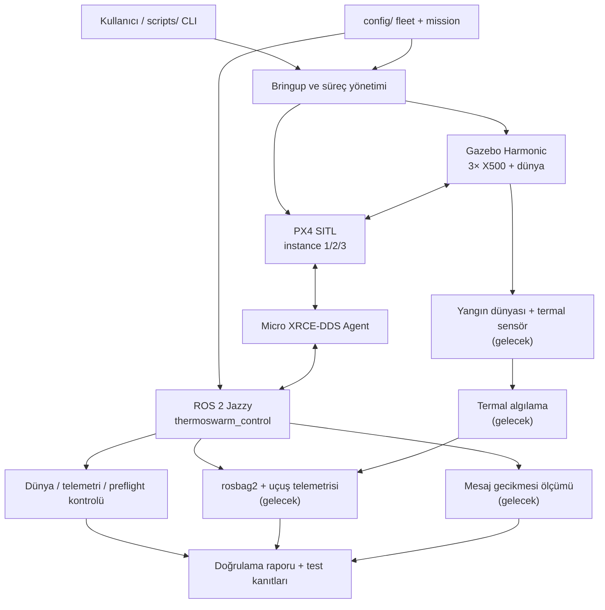

# ThermoSwarm — Önerilen Depo ve Yazılım Mimarisi

> **Durum:** Tasarım önerisi (19 Ekim 2026). Bu dosya önerilen **hedef yapıyı** anlatır; klasörlerin ve bileşenlerin tamamının bugün mevcut olduğu anlamına gelmez.
>
> **Hedef:** Çalışan üçlü PX4–Gazebo–ROS 2 SITL demosunu bozmadan, 15 Kasım teslimine uygun ve sonraki termal/dijital ikiz geliştirmelerini taşıyabilecek profesyonel, tekrarlanabilir bir araştırma-yazılım deposu oluşturmak.

## 1. Tasarım ilkeleri

1. **Tek depo, tek giriş noktası:** Kurulum, başlatma, doğrulama ve demo komutları standartlaştırılır.
2. **ROS 2 doğal yapısı:** Gerçek ROS düğümleri `ros2_ws/src/` altındaki `ament_python` paketlerinde; kabuk komutları `scripts/` içinde yaşar.
3. **Tek doğruluk kaynağı:** Araç kimliği, namespace, spawn pozisyonu ve uçuş hedefleri sürümlü YAML yapılandırmasında bulunur; aynı değerler farklı Python ve Bash dosyalarında kopyalanmaz.
4. **Uçuş güvenliği ve fail-closed:** Gazebo'da sahipsiz/çakışan model varsa uçuş başlamaz. Varsayılan komut salt-okunur denetimdir; uçuş açık `--execute` ister.
5. **Reprodüksiyon:** PX4, px4_msgs ve kritik simülasyon bağımlılıkları doğrulanmış sürümlere/commit'lere sabitlenir; kurulum yöntemi belgelenir.
6. **Test kanıtı dürüstlüğü:** İlk başarılı üçlü uçuş, tüm termal dijital ikizin bittiği anlamına gelmez. Tamamlanan modüller ile planlanan modüller açıkça ayrılır.
7. **Minimum başlangıç kapsamı:** İçinde kod bulunmayan gelecek ROS paketleri bugün oluşturulmaz; mimaride yeri ayrılır.

## 2. Sistem mimarisi



**Sorumluluk sınırları:** Gazebo fiziği/sensörleri simüle eder; PX4 her İHA'nın uçuş kontrolünü yürütür; Agent PX4↔ROS 2 iletişimini sağlar; `thermoswarm_control` görev planını, telemetriyi ve güvenli sonlandırmayı yönetir. Gelecekteki algılama, kayıt ve gecikme ölçümü uçuş kontrolünden ayrı ROS 2 düğümleri olarak eklenir.

## 3. Hedef depo ağacı

`[sonra]` işaretli bileşenler **henüz geliştirilmemiştir**; başlangıç mimarisi bunları barındıracak şekilde tasarlanmıştır.

```text
thermoswarm/
├── README.md
├── LICENSE                         # Lisans kullanıcı tarafından seçilecek
├── .gitignore
├── .env.example                    # Gerekli ise; parola/özel bilgi içermez
├── Makefile                        # Kısa, belgeli developer komutları
│
├── .github/
│   └── workflows/
│       └── checks.yml              # En azından statik/birim testleri
│
├── config/
│   ├── fleet.yaml                  # 3 araç: sysid, instance, namespace, pozisyon
│   └── missions/
│       └── square_3uav.yaml        # 5/8/11 m; 2 m kare waypoint planı
│
├── deps/
│   ├── ros2.repos                  # px4_msgs vb. kaynak bağımlılıkları
│   └── versions.md                 # PX4/ROS/Gazebo/Agent sürüm matrisi
│
├── ros2_ws/
│   └── src/
│       ├── thermoswarm_control/    # ŞİMDİ: tek ROS 2 Python uçuş paketi
│       │   ├── package.xml
│       │   ├── setup.py
│       │   ├── resource/
│       │   └── thermoswarm_control/
│       │       ├── __init__.py
│       │       ├── fleet_mission.py
│       │       ├── offboard.py
│       │       ├── telemetry.py
│       │       └── safety.py
│       │
│       ├── thermoswarm_bringup/    # ŞİMDİ: ROS launch ve bileşen başlatma
│       │   ├── package.xml
│       │   ├── setup.py
│       │   ├── resource/
│       │   └── launch/
│       │       └── fleet.launch.py
│       │
│       ├── thermoswarm_perception/ # [sonra] termal algılama
│       ├── thermoswarm_recording/  # [sonra] rosbag2/metadata
│       ├── thermoswarm_monitoring/ # [sonra] gecikme ölçümü
│       └── px4_msgs/               # HARİCİ bağımlılık; sürümü sabit, kodu vendorlama yok
│
├── simulation/
│   ├── worlds/                     # [sonra] wildfire_world.sdf
│   ├── models/                     # [sonra] termal sensörlü X500 varyantı
│   └── README.md                   # Dünyanın/modelin kurulumu ve sınırları
│
├── scripts/                        # Kısa CLI/shell katmanı; iş mantığı değil
│   ├── setup.sh                    # Kurulum önkoşulları ve bağımlılıklar
│   ├── sim.sh                      # start / status / stop; süreç sahipliği
│   ├── check.sh                    # GZ CHECK + AUDIT
│   └── demo.sh                     # Check → açık onaylı execute → özet
│
├── tools/                          # ROS düğümü olmayan teşhis araçları
│   ├── gazebo_world_check.py
│   └── ulog_analysis.py            # [sonra] log analizi kolaylaştırıcısı
│
├── tests/
│   ├── unit/                       # Mock/fake mesaj ve kontrol mantığı
│   ├── integration/                # Canlı SITL; ayrı ve açık komutla
│   └── fixtures/                   # Küçük test girdileri
│
├── docs/
│   ├── ARCHITECTURE.md
│   ├── SETUP.md
│   ├── RUNBOOK.md                  # Başlatma, arıza ve güvenli kapatma
│   ├── ROADMAP.md
│   ├── TROUBLESHOOTING.md
│   └── evidence/
│       └── 2026-10-19-three-uav.md # 3/3 PASS test raporu ve log referansları
│
├── assets/
│   ├── architecture.png            # [sonra] mimariden türetilebilir görsel
│   └── demo/                       # Gerçek, doğrulanmış demo ekran görüntüleri
│
├── examples/
│   └── single_uav/                 # Çalışan tek uçak smoke testleri
│
├── external/                       # .gitignore: yeniden indirilebilir ağır depolar
│   └── PX4-Autopilot/              # ŞİMDİKİ KONUMDAN DAHA SONRA TAŞINACAK
│
├── artifacts/                      # .gitignore: bag, ULog, büyük log, çıktılar
├── .venv-ros/                      # .gitignore
└── .venv-logs/                     # .gitignore
```

**Not:** İlk refaktörde `PX4-Autopilot/` dizinini taşımayacağız; mevcut çalışan yol korunacak. `external/` hedef düzen olarak tanımlıdır ve ancak başlatma betikleri parametreli hale getirildikten sonra, regresyon testleriyle geçilecektir. Aynı şekilde gelecekteki paketlerin boş iskeletleri bugün oluşturulmayacaktır.

## 4. İşlevsel modüller ve teslim bağlantısı

| Modül | Sorumluluk | 19 Ekim durumu | Hoca teslimi |
|---|---|---|---|
| `thermoswarm_control` | 3× arm, Offboard, waypoint, iniş, abort | Çalışan v3 prototipi mevcut | 15 Kasım / Madde 2 |
| `thermoswarm_bringup` | Çoklu başlatma ve launch | Betik/launch standardizasyonu gerekli | 15 Kasım / Madde 1 |
| `tools/gazebo_world_check` | Yetim model / çakışma denetimi | Çalışıyor | Güvenilir demo için çapraz gereksinim |
| `thermoswarm_perception` | Termal kamera verisi ve sıcak alan gözlemi | Plan | 15 Aralık / Madde 3 |
| `thermoswarm_recording` | rosbag2: kimlik, poz, hız, attitude, sensör, zaman damgası | Plan | 15 Aralık / Madde 4 |
| `thermoswarm_monitoring` | ROS 2 gecikme metrikleri ve raporlama | Plan | 31 Ocak / Madde 5 |

**Jetson taklidi:** Ayrı fiziksel Jetson aygıtı gerekmeden ROS 2 perception düğümü/compute stage olarak ele alınır. Daha sonra hedef donanıma taşıma mimari gereksinimidir; Ocak tesliminde gerçek cihaz beklenmez.

## 5. Tek konfigürasyon ilkesi

Örnek; değerler uçuş testindeki doğrulanmış değerlerdir:

```yaml
# config/fleet.yaml — önerilen şema
vehicles:
  - name: x500_1
    px4_instance: 1
    system_id: 2
    namespace: /px4_1
    spawn_xy_m: [0, 0]
    takeoff_altitude_m: 5
  - name: x500_2
    px4_instance: 2
    system_id: 3
    namespace: /px4_2
    spawn_xy_m: [5, 0]
    takeoff_altitude_m: 8
  - name: x500_3
    px4_instance: 3
    system_id: 4
    namespace: /px4_3
    spawn_xy_m: [10, 0]
    takeoff_altitude_m: 11
```

Konfigürasyon okuyucu, `name`, `px4_instance`, `system_id` ve `namespace` benzersizliğini ve model aralıklarını doğrulamalıdır. Python kontrol düğümü ve PX4 başlatıcı aynı dosyayı okumalıdır. Bu örnek YAML **henüz mevcut uygulamada okunmuyor**; migration sırasında adapte edilecektir.

## 6. Operasyonel komut sözleşmesi

Aşağıdakiler **hedef komutlar**; henüz uygulanmış gibi sunulmaz:

```bash
./scripts/setup.sh --check      # Önkoşul kontrolü; hiçbir sistemi değiştirmez
./scripts/sim.sh start          # Agent + Gazebo/PX4 üç instance
./scripts/check.sh             # Dünya denetimi + telemetri/preflight
./scripts/demo.sh --execute    # Açık niyetle görev uçuşu
./scripts/sim.sh status         # Aktif süreçler, sistemler, dünya model sayısı
./scripts/sim.sh stop           # Yalnızca bu proje tarafından başlatılan süreçler
```

Başlatma davranışı: eski bir Gazebo sunucusu bulunursa **otomatik tekrar kullanım veya kör `pkill` yapılmaz**; açık tanı gösterilerek durdurulur. `stop`, PID kayıtlarına ve gerçek süreç doğrulamasına dayanır; alakasız Gazebo/PX4 işlemlerini kapatmaz. `check` salt-okunur olmalıdır. `demo` ön koşullar geçmeden uçuş komutu göndermemelidir.

## 7. README tasarımı

Örnek `satellite-thermal-digital-twin` README'sinden **düzen disiplini** alınır; AOI, GEE, Step8/Step9 ve bilimsel sonuç içeriği kopyalanmaz.

Önerilen akış:

1. Proje adı + kısa dürüst tanım: “ROS 2/PX4/Gazebo üzerinde çoklu İHA termal dijital ikiz **SITL prototipi**.”
2. Gerçek mimari görseli ve gerçek demo görseli (sahte simülasyon görüntüsü değil).
3. `Current Status` tablosu: 3/3 uçuş PASS, termal dünya **planned**, rosbag2 **planned**, latency **planned**.
4. `Quick Start`: prerequisites → start → check → demo → stop.
5. Kısa mimari diyagram ve modül sorumlulukları.
6. Demo/test kanıtları: 19 Ekim logundan 3/3, 15/15 waypoint, iniş/disarm.
7. Yol haritası ve teslim tarihleri.
8. Reproducibility, SITL-only güvenlik notları, lisans ve ayrıntılı doküman bağlantıları.

Rozetler yalnızca doğrulanmış durumları göstermelidir; “thermal wildfire detection operational” gibi henüz desteklenmeyen iddialar kullanılmaz.

## 8. Güvenli geçiş planı

### A — 20–25 Ekim: mevcut yapıyı sağlamlaştırma

- 3–5 bağımsız temiz başlatma/iniş koşusu gerçekleştir; her koşuda 3/3 ve 15/15'i doğrula.
- Logları, komutları ve sürüm matrisini kaydet.
- Yeni başlatma betiklerini mevcut `PX4-Autopilot/` yolunu koruyarak oluştur.
- Yetim model varsa fail-closed davranışını ve kontrollü kapatmayı doğrula.

### B — 25–28 Ekim: repo mimarisi/refaktör

- Önce bu mimari dokümanını ve klasör sözleşmesini kabul et.
- Mevcut `scripts/*.py` dosyalarının çalışan halini yedekle/etiketle; silme.
- `thermoswarm_control` ve `thermoswarm_bringup` adlı iki başlangıç ROS 2 paketini kur.
- Uçuş mantığını aşamalı taşı: telemetri → komut doğrulama → görev state machine.
- Eski v3 komutu geçiş süresince çalışsın; yeni ROS 2 girişi aynı 3/3 testi geçmeden eski dosyaları kaldırma.
- Testleri `tests/` dizinine taşı ve hem eski hem yeni yoldan doğrula.

### C — 29 Ekim–1 Kasım: repo sunumu ve paylaşım

- `.gitignore`, README, sürüm kilitleri, minimal GitHub CI, setup/runbook yaz.
- Büyük PX4 ağacını, ROS build/install/log dizinlerini, venv, ULog/rosbag ve secret'ları commit etme.
- Temiz klon + documented setup + GZ CHECK/AUDIT + en az bir başarılı uçuşla reprodüksiyonu kanıtla.
- GitHub'a ancak kullanıcı onayıyla yükle.

### D — Kasım–Ocak: aşamalı ekleme

- Yangın dünyası + termal sensör + algılama düğümü.
- rosbag2 + timestamp'li fleet/sensör kayıtları.
- ROS düğümler arası gecikme izlemesi ve raporlama.
- 5 Ocak hedef demo; 31 Ocak resmî son kontrol.

## 9. Kabul ölçütleri

**Mimari değişimi başarılı saymak için:**

- Yeni komutların tamamı README/runbook'ta belgeli.
- `GZ CHECK PASS`, `AUDIT PASS` ve uçuş sonunda 3/3 + 15/15 PASS.
- Tek X500 smoke testi bozulmadı.
- Aynı makinede yeni shell/WSL oturumundan tekrar başlatılabiliyor; ikinci makinede/temiz ortamda doğrulama varsa ayrı raporlanıyor.
- VS Code/venv ayarları sistem ROS paketlerini bozmuyor; runtime için ROS setup source edilmeye devam ediliyor.
- `--execute` olmadan araçlara uçuş komutu gönderilmiyor.
- Çoklu Gazebo model çakışması sessizce geçilmiyor.

## 10. Açık kararlar

- Depo adı: `thermoswarm` mı `thermal-swarm-sitl-poc` mu? Öneri: **`thermoswarm`** (kapsam zamanla genişleyecek).
- Lisans: mevcut uydu repo MIT olsa da bu proje için ayrıca seçilmeli; otomatik kopyalanmamalı.
- Python paketleme: başlangıçta `ament_python` ve mevcut sistem ROS 2 bağımlılıkları.
- Docker: kurulum alternatif olarak belgelensin; WSL+Gazebo üzerinde çalıştığı gösterilmeden “Docker one-click” vaadi verilmesin.
- Uydu-termal araştırma deposuyla ileride entegrasyon, **ayrı bir adapter** üzerinden olabilir; şu an iki kod tabanı birbirine bağlanmamalı.
